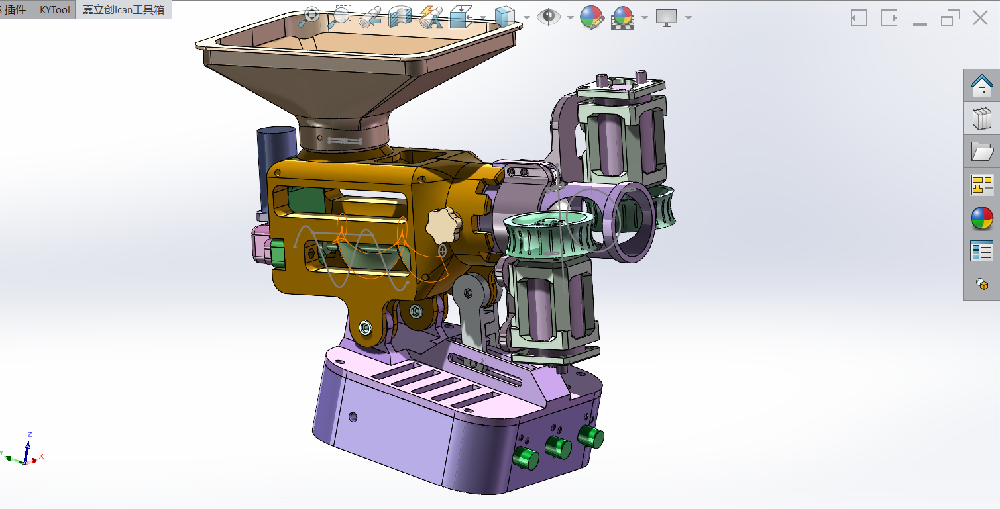
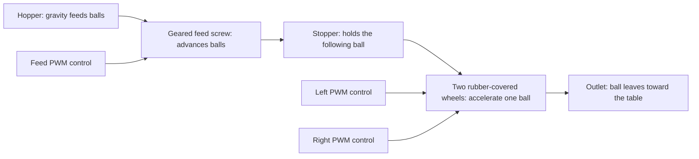

# Ping Pong Launcher

A static website with four launcher tabs: the supplied 3D-printed launcher, [codyhsu’s Arduino launcher](https://www.mobile01.com/topicdetail.php?f=696&t=5867234), PingPongThrower (Pico 2 W), and [Nguyen Van Hien’s Bluetooth Table Tennis Robot](https://www.youtube.com/watch?v=-pSiuAdUKP4).

The original launcher has a complete build guide. It includes English source translations, an interactive Three.js CAD viewer, a 13-step animated assembly wizard, a parts list, and printable model downloads.



**Build status:** documented prototype. The source includes a physical prototype, but this English guide has not been validated through a complete build. Resolve the [open build questions](docs/build-notes.md) before ordering or operating the hardware.

## How the ball-throwing mechanism works

The launch energy comes from **two motor-driven, rubber-covered wheels**. Their rotating mass stores energy. Friction transfers some of that energy to the ball when it passes between their rims.

The “exhaust” is the **outlet tube**. It guides the ball toward the wheel contact region and the exit. The wheels provide the throwing force.



1. **The hopper stores the balls.** Gravity brings a ball to the feed opening.
2. **The geared motor turns the feed screw.** The screw advances balls toward the launch head.
3. **The stopper separates consecutive balls.** It helps prevent one ball from dragging the following ball into the wheels.
4. **The two wheel surfaces grip the ball.** Both contact surfaces move toward the exit, although the wheels rotate in opposite directions.
5. **The ball accelerates through friction.** Rubber improves traction and provides compliance at contact.
6. **The ball leaves the wheel contact region.** Its momentum carries it forward. The tilt angle sets the initial launch direction.

The feeder meters balls into the launch region. It is separate from the wheel mechanism that supplies launch energy. The feeder PWM mainly changes the feed interval. The other two PWM controls change the two launch motors independently.

### Speed, grip, and spin

A wheel’s rim speed depends on its radius and measured rotational speed:

```text
rim speed v = 2 × π × wheel radius r × rpm / 60
```

Use meters for `r` to obtain meters per second. The real exit speed also depends on contact pressure, rubber, slip, wheel inertia, motor torque, and speed loss during a shot. A PWM knob position is not a measured rpm or ball speed.

For an ideal pair of opposing, parallel wheel contacts with no slip, ball translation is approximately the average of the two contact speeds. The difference produces spin:

```text
ideal ball speed ≈ (v1 + v2) / 2
ideal spin rate  ≈ (v1 - v2) / (2 × ball radius)  [radians per second]
```

These equations describe a simplified contact model, not a calibrated prediction for this CAD. Actual contact angles, rubber compression, and slip change the result. Similar contact speeds reduce differential spin in that model. Unequal speeds add spin about the axis determined by the wheel arrangement.

The source does not specify the final rubber thickness, wheel gap, motor rpm, exit speed, or spin calibration. Measure those values during a guarded physical build. [The website](docs/index.html) explains the ball path alongside the model.

## Start the local website

Use Node.js 22 or newer. The website and development server require **no package installation**.

```sh
make serve
```

Open **http://127.0.0.1:4173**. `make serve` regenerates and validates the current site before opening the preview server. The server watches `docs/` and reloads the browser after a change. An edit to `docs/data/project.json` also regenerates the written guide and BOM.

```sh
make serve PORT=4200   # choose another local port
make build             # regenerate, check, and export dist/
make check             # regenerate and validate current content
npm run check        # check content, links, inventory, and GLB structure
npm run build        # regenerate documentation and copy the site to dist/
```

The local server binds to `127.0.0.1` by default. The exported site has no server requirement. All Three.js modules, models, photos, and fonts are local; there are no runtime CDN requests.

## Arduino launcher study

Open `?launcher=mobile01` to link directly to the second tab. Arrow keys, Home and End switch tabs; the URL supports reload and browser Back/Forward. Old section links still open the printed launcher.

Read [the analysis and design notes](docs/mobile01-analysis.md). The new diagrams explain the mechanism and a proposed electrical arrangement; they do not claim original CAD dimensions or verified original GPIO assignments. The KiCad download is an **unrouted placement draft**, with pads and named nets. It has no fabrication outputs and has not passed KiCad DRC or a physical build.

`docs/data/mobile01.json` records the parts and proposed connection map. The matching table and CSV files are maintained alongside it. Regenerate the three SVG diagrams, PCB and pad netlist with `python3 scripts/create-mobile01-assets.py`; the normal Node-only build uses the checked-in outputs.

## Bluetooth table tennis robot study

Open `?launcher=hien` to link directly to the fourth tab (Nguyen Van Hien's project).

Read [the technical analysis report](docs/hien-analysis.md). The tab features:
- **Interactive mechanism exploration:** 5-step animated ball flow showing bucket gravity fill, agitator stirring, servo escapement metering, curved feed drop, DT750 twin-flywheel launch, and pan/tilt trajectory vectoring.
- **Shot mode & spin comparison:** 4 practice drills (Service, Attack, Backspin Chop, Oscillating Swing) reconstructed from the creator's custom iOS BLE app.
- **Synchronized BOM & Wiring tables:** 21 parts with evidence ratings, and 14 connection rows downloadable as CSVs (`docs/downloads/hien-parts.csv` and `docs/downloads/hien-connections.csv`).
- **Vector technical diagrams:** Native SVGs for the mechanism (`docs/assets/hien/mechanism.svg`), electrical schematic with ATX split power rails and Mega GPIO assignments (`docs/assets/hien/schematic.svg`), and KiCad breakout board placement (`docs/assets/hien/pcb.svg`).
- **Unrouted KiCad placement draft:** 85 × 60 mm dual-layer board (`docs/downloads/hien-servo-breakout.kicad_pcb`) and netlist CSV (`docs/downloads/hien-pcb-netlist.csv`). Regenerate assets using `python3 scripts/create-hien-assets.py`.

## Build the launcher

Start with [the full English assembly guide](docs/assembly-guide.md). Use the website wizard to explore the CAD groups and track your checks on the current device.

| Build resource                           | File                                                                                       |
| ---------------------------------------- | ------------------------------------------------------------------------------------------ |
| Shopping checklist                       | [Website-ready checklist](docs/shopping-list.md) · [CSV](docs/downloads/shopping-list.csv) |
| Hardware and tools                       | [English BOM](docs/hardware-bom.md) · [CSV](docs/downloads/hardware-bom.csv)               |
| Component image sources                  | [Photo references and rights](docs/component-image-sources.md)                             |
| Print settings, orientations, and plates | [Print guide](docs/print-guide.md)                                                         |
| English print project                    | [28 objects on 10 plates](docs/downloads/launcher-english.3mf)                             |
| Individual STL files                     | [ZIP, organized by plate](docs/downloads/launcher-stl-pack.zip)                            |
| Editable CAD                             | [STEP assembly](docs/downloads/launcher-assembly.step)                                     |
| Wiring and first power-on                | [DC topology and checks](docs/wiring-guide.md)                                             |
| English annotations and terminology      | [Source translation](docs/translation.md)                                                  |
| Offline written instructions             | [Guide ZIP with reference photos](docs/downloads/english-build-guide.zip)                  |
| Missing details and source differences   | [Build notes](docs/build-notes.md)                                                         |

The source specifies two 12 V 550 motors, one 12 V / 77 rpm geared motor, three PWM controllers, four 7 × 16 × 5 mm bearings, and a 12 V / 3 A supply. These are source specifications, not a verified motor-current budget. The CAD and spreadsheet disagree on some screw lengths and tilt hardware.

The print project stores a Bambu Lab A1 mini profile, a 0.4 mm nozzle, 0.20 mm layers, four walls, 25% infill, and manual tree supports. All 28 objects use slot 1, saved as PETG. Select your actual printer and material before slicing. Inspect the original orientations and painted supports.

WARNING: Disconnect power before assembly or adjustment. Wait for all moving parts to stop.

WARNING: Fit guards around accessible wheels, gears, and the feeder before operation. Keep hands clear of pinch points.

## Edit quickly

The project uses native browser modules and a small Node server. Content and behavior are separated.

```text
docs/
  index.html                 Page structure and fixed explanatory sections
  styles.css                 Responsive styles and reduced-motion handling
  app.js                     Parts filters, plate cards, and viewer setup
  viewer.js                  Three.js loading, picking, orbiting, and animation
  wizard.js                  Steps, navigation, and browser-local progress
  shopping.js                Shopping checklist and gathered-item progress
  storage.js                 Shared storage helpers with failure handling
  data/project.json          Main editable content: BOM, tools, checks, steps
  data/print-inventory.json  Generated geometry and plate report
  assets/                    Local GLB, photos, plate previews, and video
  downloads/                 English 3MF, STL pack, STEP, CSV, and guide ZIP
  vendor/                    Pinned Three.js 0.180.0 modules and license
scripts/
  serve.mjs                  Local preview and live reload
  generate-docs.mjs          Written guides, BOM, and deterministic document ZIP
  check.mjs                  Content, link, module, and asset checks
  build.mjs                  Generate, check, export to dist/
  import-step.mjs            Optional CAD tessellation
  create-viewer-model.mjs    Optional conversion to grouped GLB
  prepare-assets.py          Optional STL and inventory regeneration
```

Edit `project.json` for parts and assembly content. It feeds both the website and generated Markdown. Do not edit generated `assembly-guide.md`, `hardware-bom.md`, `print-guide.md`, or `build-notes.md` directly. Edit their content or generator template instead. Translation, wiring, and attribution documents are maintained directly.

The GLB contains 101 meshes from the actual supplied STEP. Both viewers share one model request and use separate scenes and materials. Off-screen rendering pauses. Animation respects reduced-motion preferences. A reference image and written instructions remain available when WebGL fails.

### Optional model regeneration

Normal content edits do not require CAD conversion or Python. To regenerate geometry, install `occt-import-js@0.0.23` for development and NumPy for the Python mesh exporter. For example, use `npm install --no-save occt-import-js@0.0.23` in a development checkout. Then run:

```sh
node scripts/import-step.mjs
node scripts/create-viewer-model.mjs
python3 scripts/prepare-assets.py
npm run build
```

The tools read the retained English-named CAD and 3MF. The Python exporter preserves source build orientations. Mesh closure checks do not establish printability, physical fit, wall thickness, or safe operating speed.

### Optional browser checks

Run `npm ci`, then `npx playwright install chromium`. Run `npm test` while the preview server is running, or `npm run test:ci` to build and test the static export without a server. `BASE_URL` selects a different preview URL. `PLAYWRIGHT_MODULE` can point to an existing Playwright module. The script checks desktop/mobile layout, wizard progress, filters, the model, reduced motion, and the image fallback.

## GitHub Pages

The repository includes [a Pages deployment workflow](.github/workflows/pages.yml). It runs on every pushed tag and by manual dispatch. A branch push alone does not deploy. It uses the [official GitHub Pages workflow](https://docs.github.com/en/pages/getting-started-with-github-pages/using-custom-workflows-with-github-pages).

1. Create or select a GitHub repository.
2. Initialize this folder with `git init -b main` if necessary.
3. Commit the files and push the `main` branch to that repository.
4. Open **Settings → Pages**.
5. Select **GitHub Actions** as the publishing source.
6. Allow tag deployments in the `github-pages` environment if deployment restrictions are enabled.
7. Create and push a tag, or run **Deploy build guide to GitHub Pages** manually.
8. Open the URL reported by the deployment job.

For example, after committing the current files:

```sh
git tag v1.0.0
git push origin v1.0.0
```

The workflow checks and builds the tagged commit, runs both browser suites against `dist/`, tests firmware logic, and creates a GitHub Release with a static-site ZIP after deployment. Each tag has its own workflow concurrency group, so a later tag does not cancel an earlier tag run. The site is one shared deployment; avoid pushing release tags out of order.

All site paths are relative, so a project URL such as `/PingPongLauncher/` works. The workflow uploads only `dist/`. It does not publish development dependencies or original input folders.

No hosted deployment is implied by these instructions. Publishing requires working GitHub authentication. Confirm redistribution rights for the supplied hardware and media before making a public repository.

## Future iterations

The next useful iteration is a documented physical build: resolve fasteners, measure currents and fits, and replace inferred steps with confirmed photographs. Follow that with guards, a verified DC system, an updated outlet/stopper, replaceable balanced tires, and measured speed control. See [FUTURE.md](FUTURE.md) for priorities and completion evidence.

## Sources and rights

The Chinese-named input files and duplicate STEP are removed after verification, as requested. Their useful contents remain as English-named CAD, print files, media, and translations. Historical filenames and SHA-256 hashes remain in [the source manifest](docs/data/source-manifest.json).

The source designer and hardware/media license are unknown. The MIT license covers newly written website and tooling code only. See [sources and rights](docs/attribution.md). Three.js retains its own MIT license. The source video audio is unchanged and has not been transcribed; English captions describe the visible mechanism.

## PingPongThrower

Open `?launcher=thrower` for the third tab: native simulation, five test phases, parts, wiring (including the 3D cable explorer), assembly and print downloads. The port uses isolated shadow DOM views styled with the app theme. `docs/thrower/` is the single maintained source for this project: edit its viewer modules, JSON, CAD, firmware and resources directly. Optional CAD and wiring tools are retained in `docs/thrower/tools/`. The build uses existing meshes and print files and needs no CAD tools.
