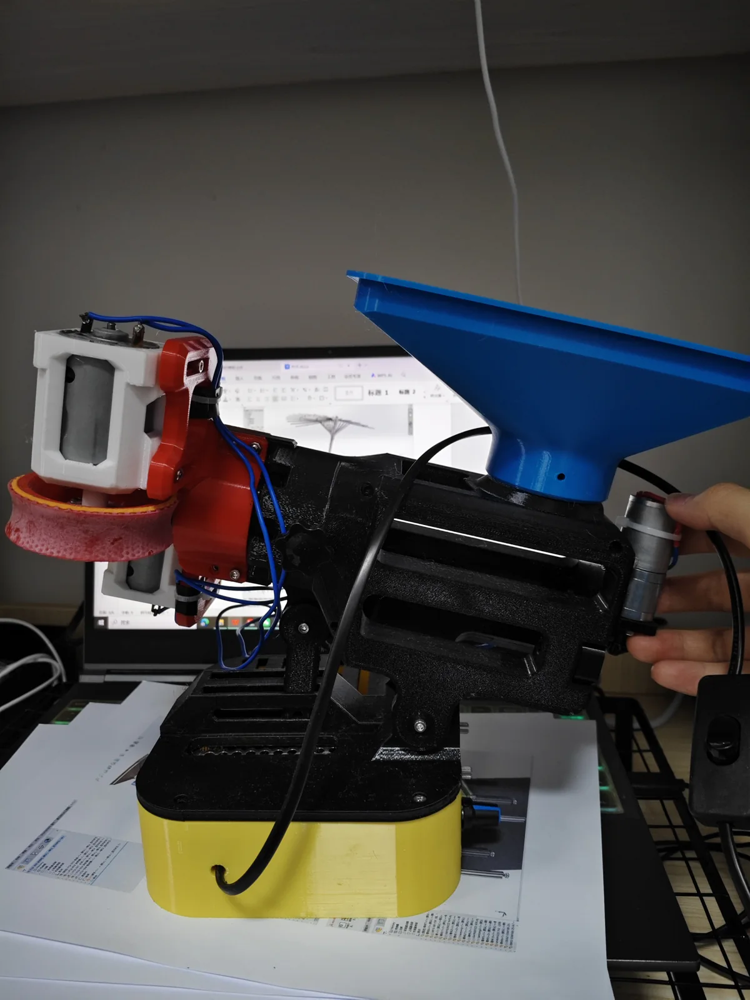
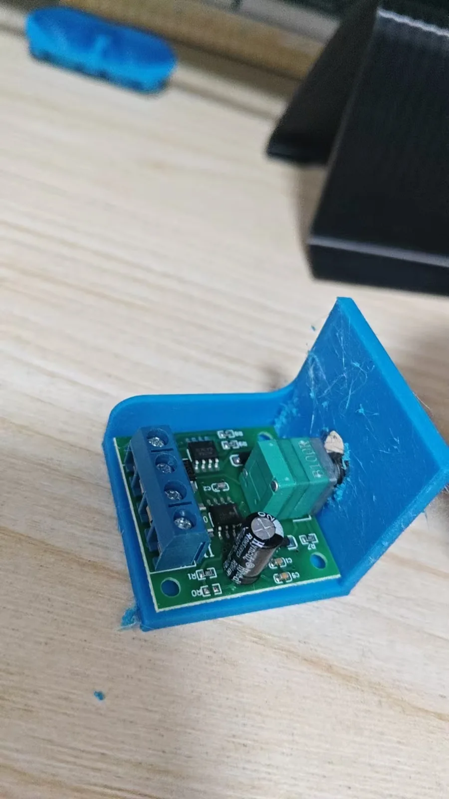
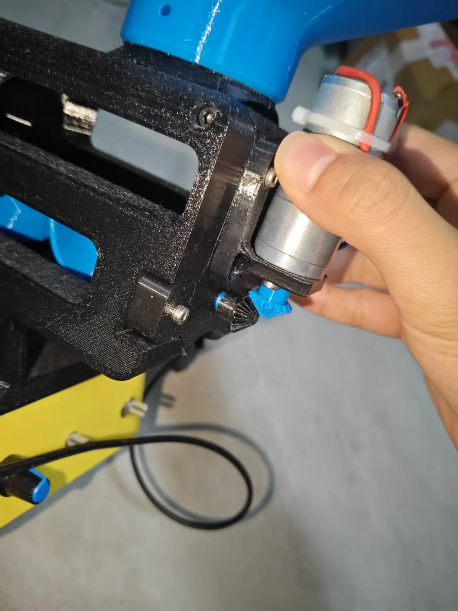
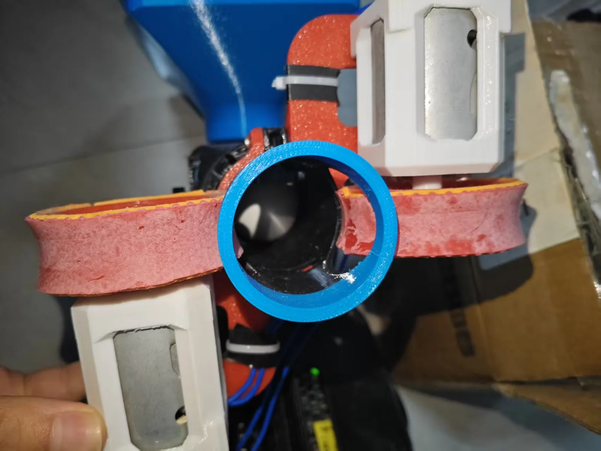
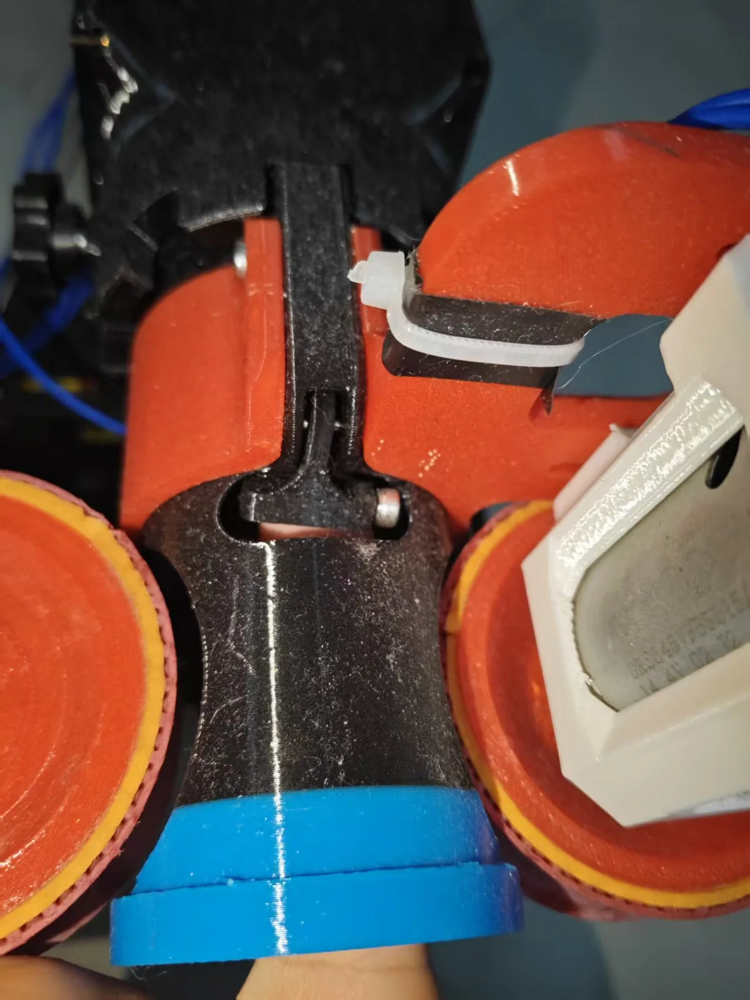

# English assembly guide

Translated from the supplied Chinese spreadsheet and annotated photographs. The assembly sequence is reconstructed from the CAD and photographs. No physical build has been validated for this guide.

WARNING: Disconnect power before assembly or adjustment. Wait for every moving part to stop.

WARNING: Fit guards around accessible rotating parts before operation. Keep hands clear of the wheels and feeder.

Read [the build notes](build-notes.md), [print guide](print-guide.md), and [wiring guide](wiring-guide.md) before a build.

## 1. Read the design

Understand the ball path before you print or buy parts.

1. Compare the STEP assembly with the prototype photograph.
2. Identify the hopper, feed screw, launch wheels, tilt support, and base.
3. Read the unresolved specifications in the build notes.
4. Record the exact motors, controllers, and power supply that you will use.

**Check:** I understand the design and have recorded the unresolved specifications.

**Build note:** The 3D geometry comes from the supplied STEP. Animation shows a suggested assembly order, not a verified insertion path.

Source: STEP assembly + prototype photograph

## 2. Prepare the hardware

Use the translated purchase list as a starting inventory.

1. Compare your hardware with each row of the parts list.
2. Measure the motor bodies, shafts, bearings, and controller boards.
3. Resolve the M3 screw-length and M5 tilt-bolt differences against the CAD.
4. Collect the tools, rubber strips, adhesive, and cable ties.

**Check:** I have checked the hardware dimensions and resolved the fastener differences.

**Build note:** The spreadsheet lists purchase quantities. It does not define every installed screw position.

Source: 元件.xls, rows 2–17 + STEP fastener names

## 3. Print and inspect the parts

Start with the saved ten-plate project and review every slice.

1. Open launcher-english.3mf in a compatible slicer.
2. Select your actual printer, nozzle, filament, and bed profile.
3. Keep the parts at 100% scale and confirm millimeter units.
4. Inspect support painting, thin walls, bridges, and every first layer.
5. Print the small bevel gears separately at a finer layer height.
6. Remove supports and inspect each part for cracks or blocked holes.

**Check:** I have inspected the slices and the printed parts, including the small gears.

**Build note:** The source recommends a lower layer height for the bevel gear but gives no value. No print time or filament total is verified.

Source: 3MF project settings + annotated image 2

## 4. Prepare the printed fits

Prepare the mating surfaces before assembly.

1. Remove support remnants and burrs from all mating surfaces.
2. Measure each shaft bore, bearing seat, and insert pocket.
3. Identify the intended insert pockets against the CAD.
4. Install heat-set inserts squarely with a temperature-controlled tool.
5. Let each insert cool before fitting a screw.
6. Dry-fit bearings and shafts without forcing them into the prints.

**Check:** The mating surfaces are clear, and the confirmed inserts, bearings, and shafts fit correctly.

**Build note:** Insert locations and fit tolerances are not dimensioned in the source. Confirm each pocket before heating or pressing hardware.

Source: Guide preparation procedure + STEP; physical fit confirmation required

## 5. Prepare the base and controls

Fit the controls while the power supply remains disconnected.

1. Locate the base enclosure, base lid, and three PWM controllers.
2. Dry-fit each board and its knob through the front panel.
3. Secure each board through its mounting holes with compatible screws.
4. Route the unpowered leads away from the lid and tilt mechanism.
5. Leave the base open for the wiring inspection.

**Check:** The boards are secure, and no screw or wire touches an exposed conductor.

**Build note:** Different PWM brands have different mounting holes. Confirm screw length and clearance under each board.

Source: Annotated image 1 + STEP base assembly

## 6. Assemble the body and feeder

Dry-fit the feed path before you tighten the body.

1. Identify both body halves, the feed screw, and the four bearings.
2. Compare each bearing location with the STEP assembly.
3. Fit the bearings without force against their shields.
4. Place the feed screw and dry-fit the body halves.
5. Turn the feeder by hand and remove any rubbing or binding.
6. Fit the tilt support and confirm free movement before tightening.

**Check:** The feeder turns freely by hand, and the body and tilt support remain aligned.

**Build note:** Insert locations, bearing fits, and tightening torques need confirmation on the actual prints. Do not pull misaligned halves together with screws.

Source: STEP body + feed assemblies; reconstructed sequence

## 7. Fit the geared feed drive

Align the small bevel gears before you secure the motor.

1. Dry-fit the geared motor, rear cover, motor mount, and bevel gears.
2. Confirm the motor shaft diameter against the printed pinion bore.
3. Align the gear axes and leave enough clearance for free rotation.
4. Secure the motor and rotate the feeder by hand again.

**Check:** The gears engage and turn without tight spots or shaft movement.

**Build note:** The original note suggests heating a tight pinion with a lighter. Use a measured bore correction instead. The gear fit is not specified.

Source: Annotated image 2 + STEP rear drive

## 8. Build the twin launch wheels

Keep both wheel assemblies concentric and balanced.

1. Dry-fit the two 550 motors in their printed mounts.
2. Fit the flanges and launch wheels using the CAD as a reference.
3. Cut matching rubber strips for the two wheel rims.
4. Bond the strips evenly with an adhesive compatible with the materials.
5. Let the adhesive cure for its specified time.
6. Turn each wheel by hand and inspect clearance, runout, and loose rubber.

**Check:** Both wheels turn freely, and the rubber is secure, even, and clear of the frame.

**Build note:** The source names 502 cyanoacrylate. Rubber thickness, finished wheel gap, speed, and balance limits are not supplied.

Source: Annotated image 3 + STEP launch assemblies

## 9. Fit the outlet and ball stopper

Prevent double feeding without blocking the ball path.

1. Fit the outlet tube between the launch wheels.
2. Compare the stopper position with the close-up photographs.
3. Fit a short filament piece or thin shaft as the stopper.
4. Move one ball through the unpowered feed path by hand.
5. Confirm that the following ball remains behind the stopper.

**Check:** One ball passes freely, and the following ball stays behind the stopper.

**Build note:** The outlet filename says revision pending. The source mentions 10 mm for the stopper but does not define the dimension clearly.

Source: Annotated images 3–4 + outlet CAD name

## 10. Attach the hopper and set the tilt

Complete the mechanical assembly before you connect power.

1. Fit the hopper to the body neck using the CAD and photograph.
2. Secure the hopper without deforming its neck.
3. Set the launcher on a stable support.
4. Adjust the tilt and tighten the compatible locking hardware.
5. Keep cables clear throughout the full tilt range.

**Check:** The hopper and tilt lock are secure, and the launcher remains stable.

**Build note:** Hopper fastener allocation and support mounting details need confirmation on the actual assembly.

Source: STEP hopper and tilt mechanism + prototype photograph

## 11. Connect the three motor channels

Use the wiring diagram as a topology guide. Confirm every terminal from the selected component documentation.

1. Disconnect the DC supply and set all speed controls to zero.
2. Identify the supply and motor terminals on each PWM controller.
3. Connect one motor to each controller output.
4. Connect the controller supply inputs in parallel through suitable branch protection.
5. Place a DC-rated switch in the positive 12 V supply lead.
6. Inspect polarity, insulation, strain relief, and continuity before power-on.

**Check:** I have confirmed component ratings, polarity, protection, and insulation for the complete circuit.

**Build note:** No verified schematic, terminal pinout, fuse values, or current measurements are supplied. Do not use the source mains-switch note as a wiring procedure.

Source: Spreadsheet electronics + guide topology; no source schematic

## 12. Commission one motor at a time

Inspect each motor channel before you introduce a ball.

1. Secure the launcher and fit guards around accessible rotating parts.
2. Keep the hopper empty and keep people clear of the outlet.
3. Use a current-limited supply for the initial motor checks.
4. Run each motor separately at its lowest stable setting.
5. Confirm that both wheel contact surfaces move toward the outlet.
6. Confirm that the feeder advances toward the launch wheels.
7. Stop immediately if a part rubs, vibrates, loosens, or overheats.

**Check:** All three channels run in the correct direction without binding, loose parts, or excessive current.

**Build note:** Confirm the real current budget before using the source 3 A supply. Disconnect power and wait for full stop before changes.

Source: Guide commissioning procedure; physical verification required

## 13. Try one ball, then tune the feed

Begin with a clear target area and the lowest useful wheel speeds.

1. Aim the launcher at a clear table or a suitable catch net.
2. Wear eye protection and keep hands clear of the feed and wheels.
3. Start the launch wheels before you start the feeder.
4. Introduce one ball and observe its path from a safe position.
5. Stop the feeder before you stop the launch wheels.
6. Disconnect power before adjusting the stopper, rubber, gears, or wheel spacing.
7. Record the settings, current, and any changes before repeating the trial.

**Check:** I have recorded a controlled single-ball trial and the adjustments that remain.

**Build note:** Increase the ball count only after repeatable single-ball feeding. No range, launch rate, capacity, or lifetime is verified.

Source: Guide trial procedure + supplied demonstration video

The website saves checklist progress in local browser storage. A checked box records your action; it does not certify the hardware.
