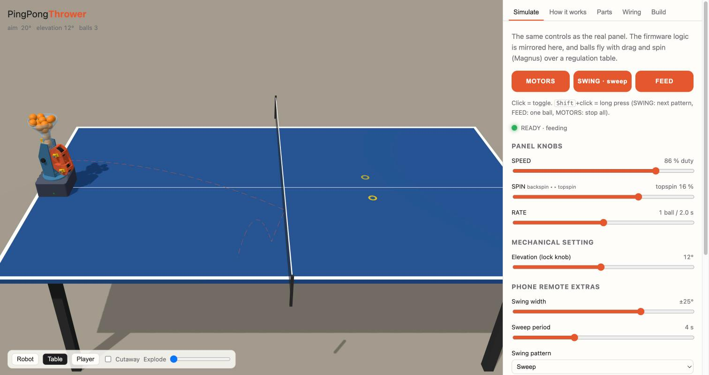
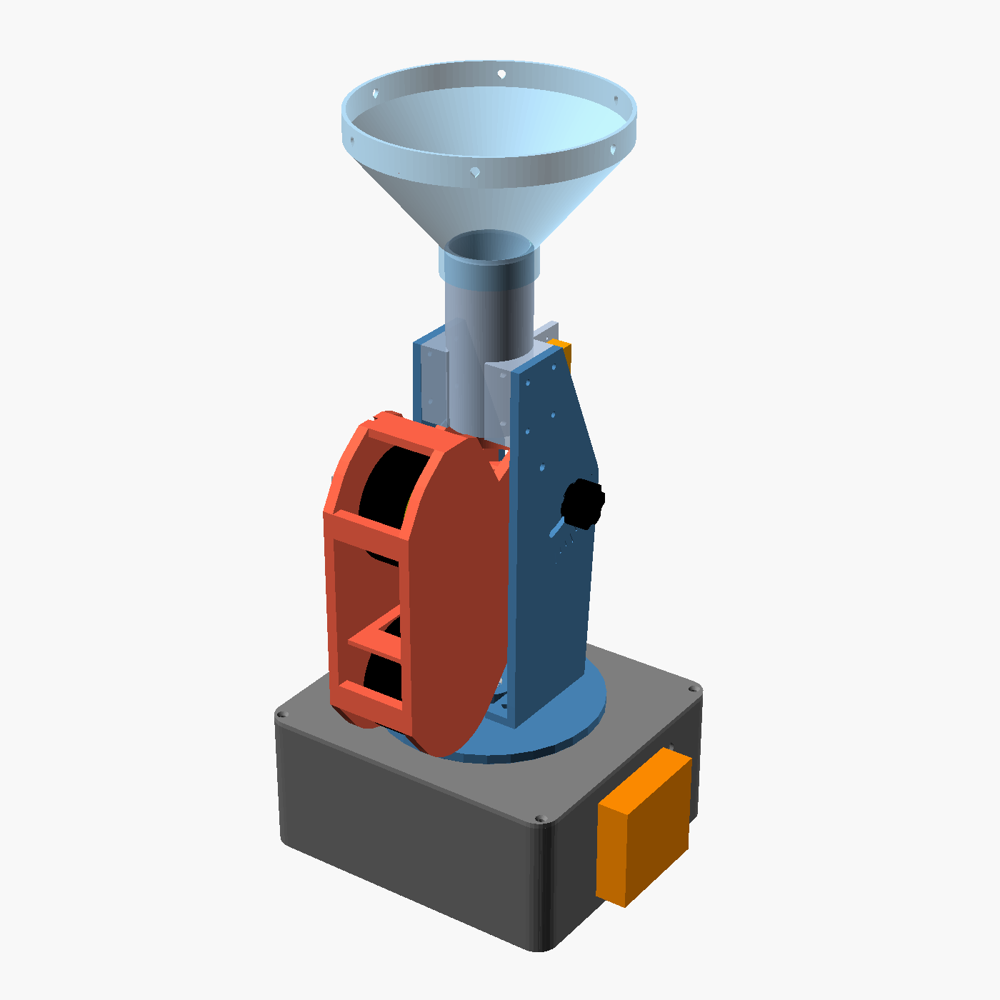
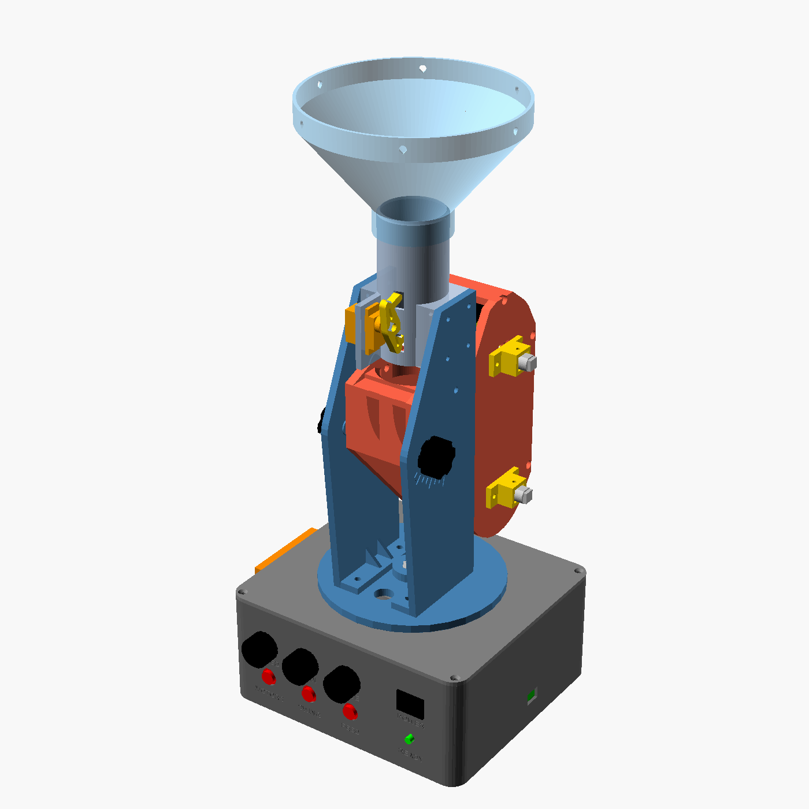
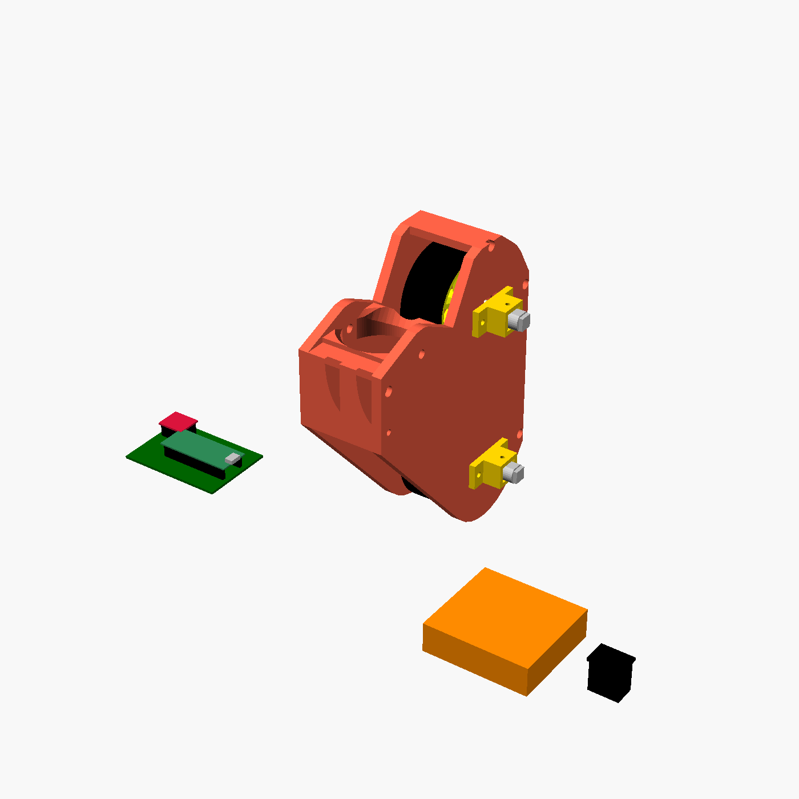
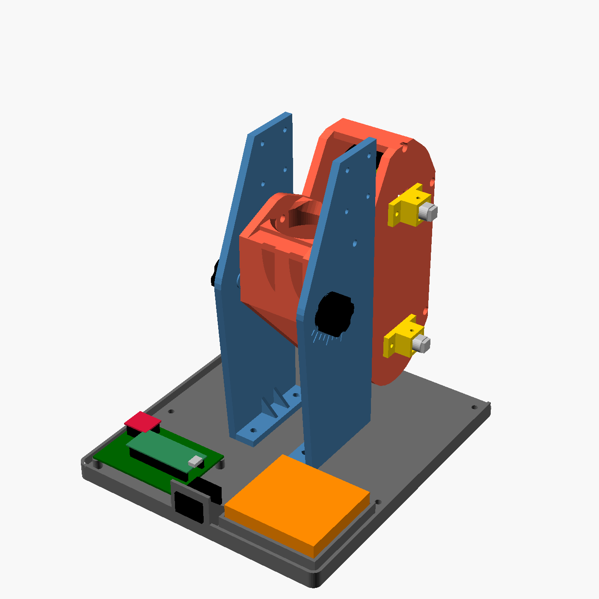
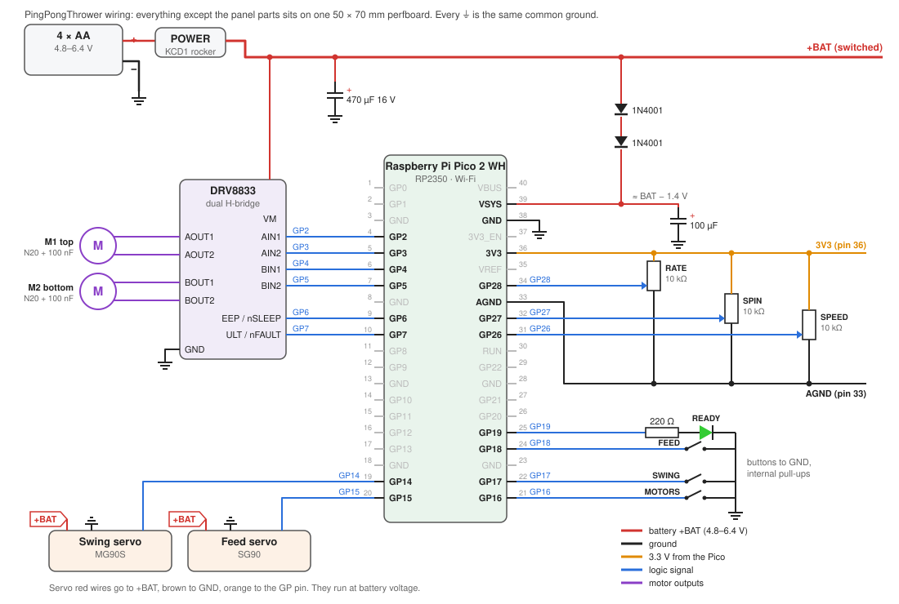

# PingPongThrower

A battery-powered table-tennis ball thrower you can build at home. It runs on a **Raspberry Pi Pico 2 WH**. Two small gearmotors spin a pair of **65 mm rubber-tyred wheels** (the common yellow TT-motor wheel, or LEGO wheels) that fire the ball, a micro servo **swings the launcher left and right**, and a second servo **feeds one ball at a time** from a basket on top. Speed, spin and feed rate are set with knobs on the base or from your phone over Wi-Fi. Every structural part is 3D-printed in PETG without supports. Everything else comes from an electronics shop or a hardware store.



| Front | Back panel |
|---|---|
|  |  |

You don't have to build it all at once. The [five test phases](#build-it-in-test-phases) start with just the printed launcher head and loose electronics on the bench, and add one mechanism at a time.

## Quick start

From the repository root, run `make serve` and open <http://127.0.0.1:4173/?launcher=thrower>. The third project tab contains simulation, five test phases, parts, wiring, and assembly. Open **Phase 1 wiring in 3D** from its Wiring view.

This directory is the maintained project source. The static export uses the checked-in models, data and print kits, with no CAD tools required.

| Resource | Location |
|---|---|
| Native viewer | `app.js`, `wiring3d.js`, `main.html`, `wiring.html`, `viewer.css` |
| CAD and print files | `cad/`, `print/stl/`, `print/3mf/`, `print/a1/` |
| BOM, test phases and assembly | `web/data/` |
| Local meshes and Three.js | `web/models/`, `web/vendor/` |
| MicroPython program and tests | `firmware/` |
| Wiring, build notes and reference images | `docs/` |
| Optional CAD and document tools | `tools/` |

For CAD regeneration, run `python3 docs/thrower/tools/build.py all` from the repository root (OpenSCAD required). `3mf` and `a1` select print-project exports. Regenerate wiring with `python3 docs/thrower/tools/wiring_svg.py` and phase instructions with `python3 docs/thrower/tools/poc_md.py`. BOM and phases are maintained directly in `web/data/`, with no duplicate hardware manifests. Run `python3 -B -m unittest discover -s docs/thrower/firmware/tests` for firmware logic checks.

## Build it in test phases

Each phase is a complete, working machine that answers one question before you spend money and print time on the next. The full plan, with parts, wiring, build steps and a test checklist per phase, is in [docs/POC.md](docs/POC.md). The viewer's **POC** tab shows the same plan, plays each build step in 3D, and has the download buttons. Pick a phase there and the Simulate tab behaves like that phase.

| Phase | What you build | Question it answers | Print | Buy ≈ |
|---|---|---|---:|---:|
| **1 · Head** | Only the head is printed: motors and wheels in it, clamped upright on the bench. Pico, DRV8833, AA pack and switch lie loose beside it. Phone remote, balls dropped in by hand | Do the N20 wheels throw fast, straight and with spin, without resetting the Pico? | 7 | 283 zł |
| **2 · Throw rig** | The head hung in its cheeks with the elevation lock, on a printed bench plate; the electronics screwed down beside it | Does it throw repeatably to one spot, and does the elevation lock hold? | 5 | 8 zł |
| **3 · Feed** | + feed tube, SG90 escapement and hopper, still on the bench plate | Does the escapement release exactly one ball at a time, at every elevation? | 3 | 14 zł |
| **4 · Aim** | The launcher moves onto the real base: tray, bearing lid, turret, MG90S swing servo. Only the power switch in the panel | Does the turret swing smoothly, hit three spots repeatably and stay put? | 5 | 30 zł |
| **5 · Panel** | + buttons, knobs and READY LED = the finished robot | Can someone run a full drill without the phone? | 3 | 19 zł |

| Phase 1: the head, clamped, electronics loose | Phase 2: the throw rig on its bench plate |
|---|---|
|  |  |

- **Prints:** `python3 docs/thrower/tools/build.py a1` (or the viewer's buttons) gives a Bambu A1 project per part and `print/a1/phaseN.zip` per phase: 0.4 mm nozzle, 0.2 mm layers, 10 % gyroid infill, PETG, no supports, every copy already on the plate. Load-bearing small parts, and the cheeks, turret and bench plate (for the self-tapped screw holes), get 6 walls instead of 4.
- **Bench plate:** its top sits exactly where the turret top will be, so the head, cheeks and tube keep their final positions and clearances. Clash checks prove the head clears the plate and the electronics at every elevation.
- **Wiring:** one diagram per phase (`docs/wiring_p1.svg` … `wiring_p5.svg`), generated from the same pin table as the firmware. Phases 1 and 2 also have a 3D view, the Wiring view in the third project tab, with every cable drawn between the exact pins on real-looking parts.
- **Firmware:** set `PHASE = 1…5` in `firmware/config.py`. Only what is fitted gets driven. Missing controls disappear from the phone page, and before phase 5 the Pico's on-board LED shows READY.

Ideas for after the tests, and what to try if a test fails, are in [docs/IMPROVEMENTS.md](docs/IMPROVEMENTS.md).

## How it works

1. **Power.** 4 × AA (4.8–6.4 V) go through the POWER rocker. They feed the motor driver and both servos directly, and the Pico through two 1N4001 diodes. The diodes drop about 1.4 V, which keeps fresh alkalines under the Pico's 5.5 V VSYS limit. A 470 µF capacitor and a soft-start ramp in firmware stop motor start-up from browning out the controller.
2. **Throwing.** Two N20 gearmotors (6 V, about 3000 rpm) each spin a wheel, one above the ball and one below. The wheels are the common yellow 65 × 26 mm TT-motor wheels with rubber tyres, on printed hubs that copy the TT shaft. LEGO Technic wheels work too (`wheel_type = "lego"`). The gap between the tyres is the ball diameter minus 2 mm, so the tyres grip the ball and throw it at roughly their rim speed. With 65 mm wheels at 3000 rpm the rim speed is 10.2 m/s, and balls leave at about 2.5–8 m/s, which is normal rally pace.
3. **Speed and spin.** A DRV8833 drives each motor with its own 20 kHz PWM. **SPEED** sets the mean duty (30–100 %). **SPIN** splits it between the wheels: a faster top wheel gives topspin (the ball dips), a faster bottom wheel gives backspin (the ball floats). There is a dead band at the centre for a flat ball.
4. **Feeding.** Balls fall from your basket through the hopper funnel into a vertical tube. A rocker on an SG90 servo pushes two fingers through windows 30 mm apart. At rest the lower finger holds the stack. To release, the rocker tips the other way. The upper finger slides in under ball 2 and lifts the stack a few millimetres off ball 1, then the lower finger pulls out and ball 1 drops alone. `tools/escapement.py` simulates this swing as part of `make check`. It checks that the finger stays clear of ball 1, that it lifts ball 2 rather than jamming against it, and that the return swing never lets two balls through. **RATE** sets one ball every 5 s down to every 0.8 s.
5. **Into the wheels.** The released ball drops into the launcher head, rolls round a 48 mm radius curved floor (the elbow) and runs into the pinch between the wheels. The head's entry sits on its tilt axis, so changing the elevation never misaligns it with the fixed tube above.
6. **Aiming.**
   - *Swing:* the whole turret turns on an M8 bolt in two 608 skate bearings. The MG90S below them only supplies torque, through a printed coupler that slides over the nyloc nut. Range ±35°. **SWING** starts and stops it. A long press cycles through *sweep*, *left·centre·right* and *random*. In the stepped patterns the turret settles before each ball.
   - *Elevation:* the head pivots between two cheeks on two M5×12 bolts. They screw through the cheeks, and their plain tips turn in bores in the head. It is locked anywhere from −5° to +30° by an M4 thumb knob in an arc slot, with tick marks every 5°.
7. **Controls.** The back panel has POWER, MOTORS / SWING / FEED, the SPEED / SPIN / RATE knobs and a READY LED. The LED blinks while the wheels spin up, stays on when ready, and flickers for each ball. The Pico 2 W also creates the Wi-Fi network `PingPongThrower`. Open `http://192.168.4.1` to get the same controls plus swing width and sweep period. A phone setting holds until you turn the matching knob again.

### Why not the TT 1:48 motors?

The original plan used TT gearmotors. With a 1:48 reduction they turn only about 200 rpm, which gives a 65 mm wheel a rim speed of 0.7 m/s. That only dribbles the ball. N20 motors with a 5:1 gearbox (about 3000 rpm at 6 V, 3 mm D-shaft) cost about 20 zł each and give the right range. Buy three: one is a spare. The TT wheels stay: a printed hub puts a TT-shaped stub on the N20's 3 mm shaft.

## Bill of materials

**Electronics** (electronics shop (Botland / Kamami / TME / Allegro))

| # | Qty | Item | Spec | ≈ zł |
|---|---:|---|---|---:|
| E1 | 1 | Raspberry Pi Pico 2 WH | RP2350, Wi-Fi + Bluetooth, soldered headers | 40 |
| E2 | 3 | N20 micro gearmotor 6 V, 5:1, ~3000 rpm | 3 mm D-shaft, 12×10 mm gearbox (e.g. Botland N20-BT40). 2 used + 1 spare | 66 |
| E3 | 1 | DRV8833 dual H-bridge module | 2.7–10.8 V, 1.5 A/ch (Pololu 2130 or red HW-627 clone) | 15 |
| E4 | 1 | Micro servo MG90S (metal gear) | swing servo, 180°, 4.8–6.6 V | 18 |
| E5 | 1 | Micro servo SG90 | ball-feed escapement, 180° | 10 |
| E6 | 1 | 4×AA battery holder, enclosed, with switch and lid | ≈67×62×19 mm, wire leads | 8 |
| E7 | 4 | AA cells | NiMH 2000+ mAh (eneloop) recommended; alkaline works (6.4 V fresh) | 40 |
| E8 | 1 | Rocker switch KCD1-101 | SPST ON/OFF, 6 A, panel cut-out 19×13 mm | 2 |
| E9 | 3 | Momentary push button, 12 mm panel mount | normally open (e.g. PBS-33B / R13-507) | 9 |
| E10 | 3 | Potentiometer 10 kΩ linear (B10K) | 16 mm body, M7 bushing, 6 mm D-shaft (flat at 4.5 mm) | 9 |
| E11 | 1 | LED 5 mm green + 220 Ω resistor | READY indicator | 1 |
| E12 | 2 | Diode 1N4001 (or 1N4007) | two in series drop 6.4 V to ≤ 5 V for the Pico VSYS | 1 |
| E13 | 1 | Electrolytic capacitor 470 µF 16 V | across the battery rail at the driver | 1 |
| E14 | 1 | Electrolytic capacitor 100 µF 10–16 V | Pico VSYS to GND | 0 |
| E15 | 2 | Ceramic capacitor 100 nF | soldered across each motor's terminals (noise) | 1 |
| E16 | 1 | Perfboard 50×70 mm | holes 2 mm from the corners (66×46 mm pitch) | 4 |
| E17 | 1 | Female header strips 2.54 mm | 2×20 for the Pico, 2×6 for the driver | 4 |
| E18 | 3 | Screw terminal 2-pin 5.08 mm | battery in, top motor, bottom motor | 3 |
| E19 | 2 | 3-pin male header | servo plugs on the perfboard | 1 |
| E20 | 1 | Wire kit | silicone 0.35 mm² red/black ~2 m, 6-core flexible cable ~0.5 m to the turret, heat-shrink | 12 |
| E21 | 2 | JST-XH 2-pin plug + socket (optional) | makes the head removable | 4 |

**Mechanical hardware** (hardware store (Castorama / Leroy Merlin / OBI) and a bearing or skate shop)

| # | Qty | Item | Spec | ≈ zł |
|---|---:|---|---|---:|
| M1 | 2 | Ball bearing 608ZZ | 8×22×7 mm (skateboard bearing) | 8 |
| M2 | 1 | Hex bolt M8×40 (DIN 933) + M8 nyloc nut | yaw axle | 2 |
| M3 | 2 | Hex bolt M5×12 + M5 washer | elevation pivots: screwed through the cheeks, the plain tip turns in the head | 1 |
| M4 | 2 | Hex bolt M4×20 + M4 washer | elevation locks, pressed into the printed knobs | 1 |
| M5 | 4 | Screw M4×10 | cheek feet → turret (self-tapping into plastic) | 1 |
| M6 | 4 | Screw M3×40 | join the two head halves | 2 |
| M7 | 4 | Screw M3×12 + M3 nut + washer | motor clamps → head (nuts sit in the head) | 1 |
| M8 | 4 | Grub screw M3×4 / screw M3×8 | 2 set screws in the hubs, 2 motor retainers in the clamps | 1 |
| M9 | 8 | Screw M3×20 | cheeks → feed-tube ears | 2 |
| M10 | 4 | Countersunk screw M3×12 | lid → tray | 1 |
| M11 | 4 | Screw M3×8 | perfboard → standoffs | 1 |
| M12 | 2 | Screw M3×10 + nut | battery holder → left wall (or double-sided tape) | 0 |
| M13 | 6 | Screw M4×10 + nut (optional) | attach your basket to the hopper collar | 1 |
| M14 | 4 | Self-adhesive rubber feet | Ø 10–15 mm | 4 |
| M15 | 10 | Cable ties | tidy the turret cable loop | 1 |

**Wheels** (Botland)

| # | Qty | Item | Spec | ≈ zł |
|---|---:|---|---|---:|
| L1 | 2 | Wheel with tyre 65×26 mm, yellow (TT-motor wheel) | Botland 14245 (EAN 5903351248181): rubber tyre, ABS rim, 5 mm bore with two flats made for a TT gearmotor shaft. The printed hub carries a matching stub. LEGO Technic wheels with a cross hole also work: set `wheel_type = "lego"` in cad/config.scad | 7 |
| L2 | 2 | Self-tapping screw M2×6 (optional) | through the wheel centre into the hub stub, if a wheel works loose | 0 |

**Filament** (3D printing shop)

| # | Qty | Item | Spec | ≈ zł |
|---|---:|---|---|---:|
| F1 | 1 | PETG filament | ≈ 0.7 kg for all printed parts (any colour; translucent looks great on the hopper) | 70 |

**Total ≈ 354 zł** (≈ 347 zł with LEGO wheels you already have). Prices are typical Polish retail (Botland, Kamami, TME, Allegro, hardware stores) in 2026, rounded; check before ordering.

The web viewer's **Parts** tab is generated from the same `web/data/bom.json`.

## Printed parts

All parts are PETG on a 256 × 256 × 256 mm bed (Bambu A1 / P1S / P1P / X1C) and print **without supports**. Parts are exported already in print orientation: lay them on the plate as they come.

| Part | Qty | Print notes |
|---|---:|---|
| [`tray`](print/stl/tray.stl) | 1 | Base box. As exported (floor down). 4 walls, 15 % gyroid. Brim optional. |
| [`lid`](print/stl/lid.stl) | 1 | Base lid, printed upside down (bearing boss up). 4 walls, 20 % gyroid. |
| [`spacer_parts`](print/stl/spacer_parts.stl) | 1 | Bearing spacer + 2 inner-race shims (3 rings, one plate). 100 % infill. |
| [`coupler`](print/stl/coupler.stl) | 1 | Servo-to-nut coupler. 6 walls, 60 % infill. |
| [`turret`](print/stl/turret.stl) | 1 | Turret plate. 4 walls, 25 % gyroid. |
| [`cheek_left`](print/stl/cheek_left.stl) | 1 | Yoke cheek, lies on its outer face. 4 walls, 25 % gyroid. |
| [`cheek_right`](print/stl/cheek_right.stl) | 1 | Yoke cheek (mirror of the left). 4 walls, 25 % gyroid. |
| [`head_left`](print/stl/head_left.stl) | 1 | Launcher head half, lies on its outer wall. 4 walls, 20 % gyroid. |
| [`head_right`](print/stl/head_right.stl) | 1 | Launcher head half with the motor pockets. 4 walls, 20 % gyroid. |
| [`motor_clamp`](print/stl/motor_clamp.stl) | 2 | N20 clamp, flange down. 6 walls, 60 % infill. |
| [`wheel_hub`](print/stl/wheel_hub.stl) | 3 | N20 D-shaft to wheel hub: TT-shaft stub for the yellow wheels (a LEGO cross with `wheel_type = "lego"`), lies on its side (1 spare). 0.12 mm layers, 100 % infill. |
| [`feed_tube`](print/stl/feed_tube.stl) | 1 | Feed tube with ears and servo plate, upright. 4 walls, 20 % gyroid. |
| [`rocker`](print/stl/rocker.stl) | 1 | Escapement rocker, flat, horn recess up. 6 walls, 60 % infill. |
| [`hopper`](print/stl/hopper.stl) | 1 | Basket adapter funnel, printed upside down (collar on the bed). 3 walls, 15 %. |
| [`knob_pot`](print/stl/knob_pot.stl) | 3 | Potentiometer knob (6 mm D-shaft). 3 walls, 20 %. |
| [`knob_lock`](print/stl/knob_lock.stl) | 2 | Elevation lock knob, press an M4×20 hex bolt in. 4 walls, 40 %. |
| [`poc_base`](print/stl/poc_base.stl) | 1 | Bench plate for test phases 2–3 only, flat. 4 walls, 15 % gyroid. |

**Settings:** 0.4 mm nozzle, 0.2 mm layers (0.12 mm for the hubs), 4 walls unless noted, 20 % gyroid, nozzle 240 °C, bed 75 °C, fan 30–40 %. Dry the PETG first. The `.3mf` files in `print/3mf/` already carry PETG Basic, the walls, the infill and supports off. For parts with Qty > 1, add instances in Bambu Studio (right-click → *Add instance*). Total filament is about 0.7 kg. For the POC print kit (A1, 0.2 mm, 10 % infill, copies already placed) see [Build it in test phases](#build-it-in-test-phases).

Holes are modelled with +0.30 mm compensation, a value measured on a Bambu X1C with PETG. If your 608 bearings are loose or too tight, change `fit_bearing` in `cad/config.scad`, run `python3 docs/thrower/tools/build.py all` and reprint only the lid.

## Wiring



| Pico pin | GPIO | Goes to |
|---|---|---|
| 4, 5 | GP2, GP3 | DRV8833 AIN1, AIN2 (top motor) |
| 6, 7 | GP4, GP5 | DRV8833 BIN1, BIN2 (bottom motor) |
| 9, 10 | GP6, GP7 | DRV8833 EEP (nSLEEP), ULT (nFAULT) |
| 19, 20 | GP14, GP15 | swing servo, feed servo (signal) |
| 21, 22, 24 | GP16, GP17, GP18 | MOTORS, SWING, FEED buttons → GND |
| 25 | GP19 | 220 Ω → READY LED → GND |
| 31, 32, 34 | GP26, GP27, GP28 | SPEED, SPIN, RATE pot wipers |
| 36, 33 | 3V3, AGND | pot outer legs |
| 39, 38 | VSYS, GND | +BAT through 2 × 1N4001, 100 µF to GND |

The full netlist, the turret cable, the reasons behind each part and a first power-up checklist are in **[docs/wiring.md](docs/wiring.md)**. To see the phase 1 circuit as real parts and coloured cables, run `make serve` and open **Phase 1 wiring in 3D** from the Wiring tab in the third project tab.

## Assembly

The viewer's **Build** tab walks through these steps and highlights the parts for each one.

1. **Print** all parts (see above). Pre-form the self-tapping holes with a plain screw.
2. **Bearings:** press one 608 into the top seat of the lid and one into the bottom seat, with the printed spacer between the inner races.
3. **Swing servo:** centre the MG90S (run the firmware once). Drop it into the tower in the tray and screw down its tabs. Screw the double horn to the coupler along X.
4. **Electronics:** build the perfboard (Pico 2 WH and DRV8833 in female headers, screw terminals for the battery and motors). Screw it onto the standoffs. Fit the switch, buttons, pots and LED into the back panel, and the battery holder onto the left wall.
5. **Turret:** pass the M8×40 down through the turret (the head sits in the hex pocket), then add the 1.5 mm shim, bearings and spacer, the 2 mm shim and the nyloc. Tighten until the turret turns freely with no wobble. The coupler slides over the nut when the lid goes on.
6. **Cheeks:** fix both feet to the turret with 4 × M4×10.
7. **Head:** push the N20s into the clamps, gearbox nose into the wall pocket. Fit the hubs with the set screw on the flat and push the wheels onto the stubs, flats lined up (an optional M2×6 self-tapper through the wheel centre holds a loose one). Join the halves with 4 × M3×40. Set the top motor in its slots so the tyres are 38 mm apart (ball − 2 mm).
8. **Hang the head** between the cheeks on the M5 pivots, and fit the M4 lock knobs through the arc slots.
9. **Feed:** screw the SG90 to the tube plate and the rocker to its horn (at neutral both fingers are half in). Screw the tube ears to the cheeks with 8 × M3×20.
10. **Hopper and basket:** slide the funnel onto the tube. Cut a Ø 140 mm hole in the bottom of your bin and screw it to the collar (6 × M4).
11. **Close up:** route the turret cable through the arc slot with a loose loop and screw the lid on. Then flash the firmware and calibrate.

## Firmware

1. Install MicroPython for the **Pico 2 W** (`RPI_PICO2_W`). Download the `.uf2` from micropython.org (Downloads → Raspberry Pi → Pico 2 W). Hold BOOTSEL while plugging in USB, then drag the file onto the `RP2350` drive.
2. Copy the program:

   ```sh
   pip install mpremote
   mpremote cp firmware/config.py firmware/logic.py firmware/hw.py firmware/web.py firmware/main.py :
   mpremote reset
   ```

3. `main.py` starts on boot. Unplug USB, switch on with POWER, and you're running on batteries.

**Test phase:** `PHASE` in `config.py` (default 5 = the finished robot) says what is fitted. Phases 1 and 2 drive only the wheel motors, phase 3 adds the feed servo, phase 4 the swing servo, and phase 5 the buttons, knobs and LED. Unfitted servos get no pulses and unfitted button pins are never read. See [docs/POC.md](docs/POC.md).

**Controls:** MOTORS toggles the wheels (a long press stops everything). FEED toggles automatic feeding and turns the motors on if needed (a long press throws a single ball). SWING toggles swinging (a long press picks the next pattern). Balls are only released once the wheels have reached speed and, in stepped patterns, once the turret has settled.

**Calibration** (all in `firmware/config.py`):

| Symptom | Setting |
|---|---|
| A wheel pushes the ball backwards | flip `TOP_REVERSED` or `BOT_REVERSED` |
| Aim is not centred | `SWING_CENTER` (servo degrees) |
| Turret hits something at the ends | lower `SWING_LIMIT` (≤ 35) |
| Feed releases two balls or none | `FEED_CENTER`, `FEED_ALPHA` (matches `esc_alpha` = 18° in the CAD) |
| Slowest setting stalls | raise `MIN_DUTY` |
| Batteries brown out on start | lower `RAMP_PER_S` |
| Wi-Fi name or password | `WIFI_SSID`, `WIFI_PASSWORD` (change the default) |

The control logic in `logic.py` has no hardware imports. Run its desktop tests with `python3 -B -m unittest discover -s docs/thrower/firmware/tests`.

## Changing the design

Every dimension lives in `cad/config.scad`, and `thrower.scad` derives everything else. Asserts and clash checks stop a change that breaks a fit. After an edit, run `python3 docs/thrower/tools/build.py all` (or keep `make serve` running and watch the viewer update).

| Want to… | Change |
|---|---|
| Use LEGO wheels instead | `wheel_type = "lego"`, then `lego_wheel_d`, `lego_wheel_w` (Technic cross-hole wheels 43–69 mm, ≤ 38 mm wide). The hub stub becomes a LEGO cross; the head, pinch and pivot height all follow. The optional CAD tool checks both wheel options. |
| Wheel loose or too tight on the hub | `tt_stub_fit` (0.1 mm under the TT shaft; more = looser). Reprint only `wheel_hub`. |
| Grip the ball harder or softer | `ball_squeeze` (default 2 mm), or slide the top motor in its slots |
| More elevation range | `pitch_min`, `pitch_max` (the clash checks prove the head clears the tube) |
| Wider swing | `yaw_max` and `SWING_LIMIT` in the firmware |
| A bigger basket opening | `hopper_top_r` (must still fit the bed) |
| Bearing seat too tight or loose | `fit_bearing`; general holes `hole_comp` |

## Expected performance

| | |
|---|---|
| Ball exit speed | ≈ 2.5–8 m/s (9–29 km/h), set by SPEED |
| Spin | up to ≈ 15 rev/s topspin or backspin |
| Feed rate | 1 ball / 5 s … 1 ball / 0.8 s |
| Swing | ±35°, sweep period 1–10 s |
| Elevation | −5° … +30°, manual |
| Launch height | ≈ 180 mm above the table at 0° |
| Runtime | ≈ 2–4 h per set of 2000 mAh NiMH (estimate) |

The simulation uses the same formulas: rim speed = π·D·rpm/60, exit ≈ 0.8 × mean rim speed, drag C<sub>d</sub> ≈ 0.5, Magnus lift from the spin ratio. Treat these figures as estimates until you measure your build.

## What only a real print can confirm

- How hard the tyres grip the ball, and how well the printed stub holds the wheel. Tune `ball_squeeze` and the top-motor slots for grip, `tt_stub_fit` for the wheel fit.
- Escapement timing with your servo (`FEED_RELEASE_S`).
- The press fit of the bearings and the D-shaft hub on your printer.
- Actual battery life.
- Whether your KCD1 switch clips into the 2.25 mm panel wall (clip ranges vary) and sits snug in the 19.5 × 13.5 mm window.
- Wheel wobble: each wheel overhangs the N20 gearbox by about 25 mm, so watch for runout in phase 1.
- Self-tapped threads (M4 cheek feet, M5 pivots): pre-form each once with a plain screw before final assembly.

The five [test phases](docs/POC.md) are designed to answer exactly these, one at a time.

## Credits

Built with OpenSCAD, MicroPython and three.js (MIT licence, see `web/vendor/three/LICENSE`).
